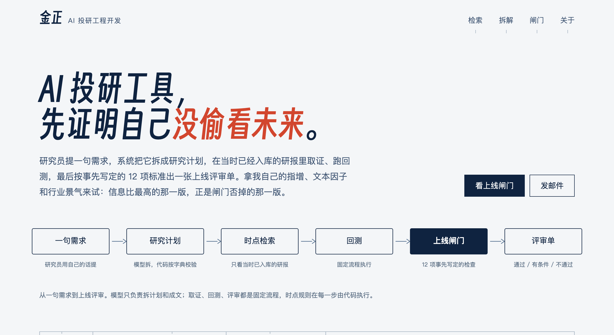

# 金正 · AI 投研工程开发

研究员提一句需求，系统拆成研究计划，在当时已经入库的研报里取证、跑回测，最后按事先写定的 12 项标准出一张上线评审单。

网站：https://joyzen2.github.io/ai-research/

- **检索问答**：5.7 万篇券商研报摘要，检索前按入库时刻过滤，时点陷阱测试零泄漏；回答逐句标出处，数字由代码核对。
- **需求拆解**：大模型把模糊需求拆成可以校验的研究计划，执行走固定流程；提示词 A/B 测试，计划完全正确率 40% → 93%。
- **上线闸门**：显著性、紧缩夏普、过拟合概率、成本压力、安慰剂、大模型知识截止日、风控阈值和回测审计；审计了 20 个候选。

这个仓库是网站本身：`content/` 里的 Markdown 由 `build.py` 生成到 `docs/`，GitHub Pages 从 `docs/` 发布。研究代码整理后另行公开。研报原文不转载，只放统计结果和出处。
